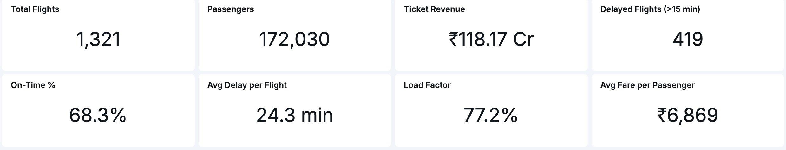
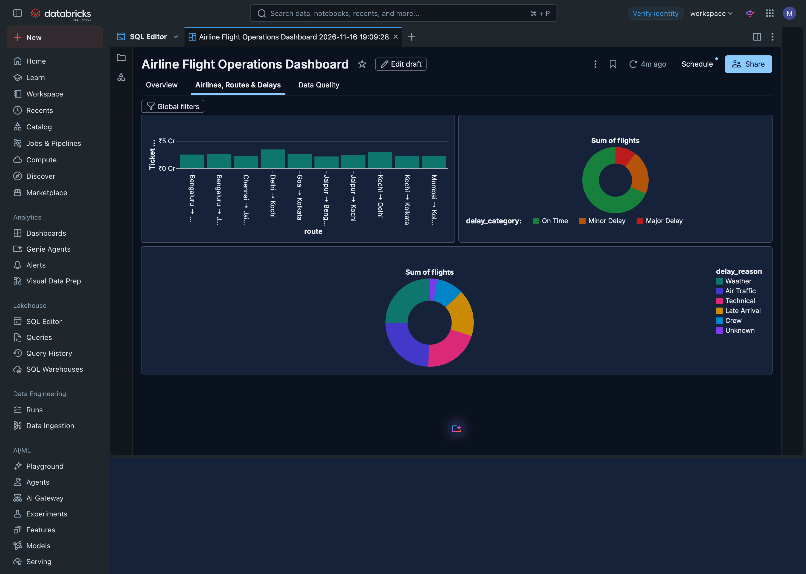
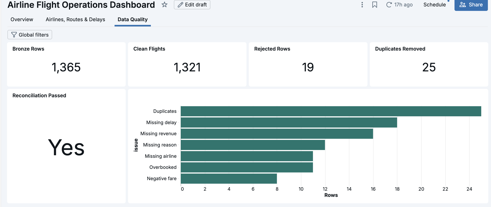

##  Databricks AI/BI Dashboard & Insights

The **Airline Flight Operations Dashboard** is built natively in Databricks SQL / AI/BI Dashboards and organized into three interactive pages with global filtering:

### 1. Executive Overview (`Overview`)
Provides an operational and financial snapshot across all carriers and routes[cite: 1]:
* **Core KPIs:** `1,321` Total Flights | `172,030` Passengers | `₹118.17 Cr` Ticket Revenue | `419` Delayed Flights (>15 min)[cite: 1].
* **Performance Metrics:** `68.3%` On-Time Performance | `24.3 min` Avg Delay per Flight | `77.2%` Load Factor | `₹6,869` Avg Fare per Passenger[cite: 1].
* **Visuals:**
  * *Monthly Trend:* Combo chart tracking monthly flight volumes against ticket revenue (₹ Cr)[cite: 1].
  * *Carrier Benchmarking:* Scatter plot comparing On-Time % vs. Average Delay (minutes) across all airlines[cite: 1].
  * *Delay Breakdown:* Horizontal bar chart categorizing flights into **On Time**, **Minor Delay**, and **Major Delay**.

KPIs:

Overview:
.png)

---

### 2. Airlines, Routes & Delays (`Airlines, Routes & Delays`)
Delivers carrier-level scorecards, route profitability, and delay root-cause analysis[cite: 3, 4]:
* **Airline Summary Scorecard:** Benchmarks **Sky Jet** (`385` flights, `₹34.55 Cr` revenue), **Air Bharat** (`322` flights, `69.9%` on-time)[cite: 3], **Blue Wing** (`267` flights)[cite: 3], **Fly Easy** (highest punctuality at `71.5%` on-time)[cite: 3], and **Coastal Air** (lowest avg delay at `20.3 min`)[cite: 3].
* **Top Routes by Revenue:** Ranks top-performing domestic corridors including *Delhi → Kochi*, *Kochi → Delhi*, *Goa → Kolkata*, *Jaipur → Kochi*, and *Bengaluru* routes[cite: 3, 4].
* **Delay Category & Root Causes:** Donut charts breaking down flight share by delay severity and operational root causes (*Weather*, *Air Traffic*, *Technical*, *Late Arrival*, *Crew*, and *Unknown*).

---

### 3. Data Quality & Pipeline Reconciliation (`Data Quality`)
Tracks pipeline health and row-level data hygiene directly from the Gold audit layer:
* **Audit Counters:** `1,365` Bronze Rows → `1,321` Clean Flights | `19` Rejected Rows | `25` Duplicates Removed[cite: 5].
* **Reconciliation Status:** `Yes` (verifies `1,321 + 19 + 25 = 1,365` with zero data loss)[cite: 5].
* **Issue Breakdown:** Horizontal bar chart quantifying specific anomalies caught during ingestion: `Duplicates` (`25`), `Missing delay` (`18`), `Missing revenue` (`16`), `Missing reason` (`12`), `Missing airline` (`11`), `Overbooked` (`11`), and `Negative fare` (`8`)[cite: 5].

)
