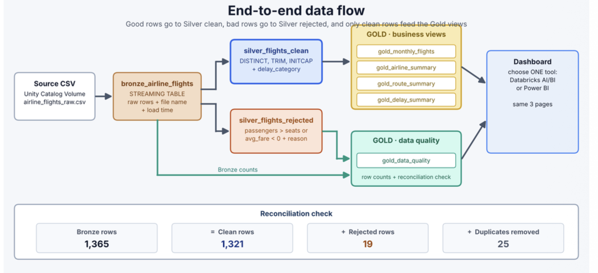
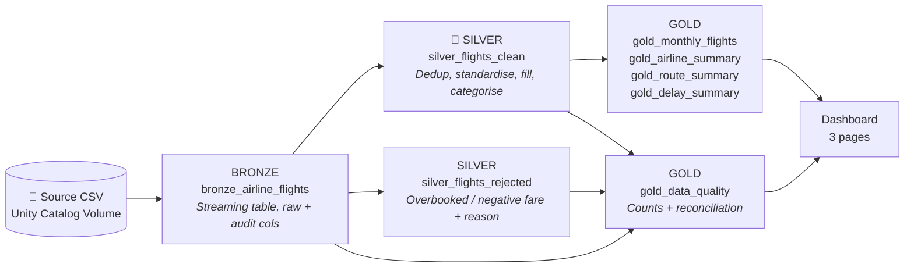
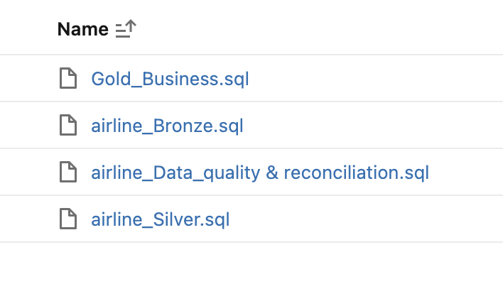

<div align="center">

# Airline Flight Operations Analytics Platform

### End-to-end Medallion Architecture on Databricks with Lakeflow Spark Declarative Pipelines




</div>

---

## TL;DR

| | |
|---|---|
| **Problem** | Raw flight exports had duplicates, blanks, inconsistent text, impossible passenger counts and negative fares. Teams calculated on-time % and load factor by hand and got different answers. |
| **Solution** | A repeatable, one-click Lakeflow pipeline (Bronze → Silver → Gold) written in SQL, with built-in data-quality expectations and a reconciliation table. |
| **Outcome** | 1,365 raw rows → **1,321 clean** + **19 rejected** + **25 duplicates removed**, with zero rows unaccounted for. |
| **Output** | 5 Gold tables + a 3-page dashboard (Databricks AI/BI or Power BI). |

---

##  Table of Contents

- [Business Context](#-business-context)
- [Architecture](#-architecture)
- [Tech Stack](#-tech-stack)
- [Data Quality Highlights](#-data-quality-highlights)
- [Gold Layer Tables](#-gold-layer-tables)
- [Dashboard](#-dashboard)
- [Documentation](#-documentation)
- [Repository Structure](#-repository-structure)
- [How to Run](#-how-to-run)
- [Skills Demonstrated](#-skills-demonstrated)
- [Credits](#-credits)
- [About Me](#-about-me)

---

## Business Context

Five fictional airline brands (Sky Jet, Air Bharat, Blue Wing, Fly Easy, Coastal Air) operate domestic flights between ten Indian cities using ATR 72, Airbus A320 and Boeing 737 aircraft. Operations managers need reliable numbers on:

- Flights, passengers and ticket revenue
- Load factor (seat usage)
- On-time performance and delay causes
- Route and airline comparisons

> A flight departing up to **15 minutes late counts as On Time**. Early departures also count as On Time.

**Dataset:** `airline_flights_raw.csv`, synthetic, 1,365 rows × 20 columns, domestic flights in 2025.

---

## Architecture



| Layer | Purpose | Object type |
|---|---|---|
| **Bronze** | Keep the source exactly as received, add `source_file` and `loaded_at` | Streaming table |
|  **Silver** | Clean, standardise, derive `delay_category`, quarantine bad rows | Materialized views |
| **Gold** | Aggregated business metrics and data-quality proof | Materialized views |

---

## Tech Stack

- **Platform:** Databricks (Unity Catalog, Volumes)
- **Pipeline:** Lakeflow Spark Declarative Pipelines (SQL)
- **Storage format:** Delta Lake
- **Ingestion:** `STREAM read_files()` from a Unity Catalog Volume
- **Data quality:** Pipeline expectations (`CONSTRAINT ... EXPECT ... ON VIOLATION DROP ROW`)
- **Visualisation:** Databricks AI/BI Dashboards *(or Power BI via the Azure Databricks connector)*

---

##  Data Quality Highlights

 Summary:

| Problem found in raw data | Rows | Treatment |
|---|---:|---|
| Duplicate flights (same `flight_id`) | 25 | Removed (kept one copy) |
| Extra spaces / mixed capitalisation | many | `INITCAP(TRIM(col))` |
| Blank airline | 11 | Filled with `Unknown` |
| Blank delay reason | 12 | Filled with `Unknown` |
| Blank delay minutes | 18 | Calculated with `TIMESTAMPDIFF` |
| Blank ticket revenue | 16 | Calculated as `passengers × avg_fare` |
| Passengers > seat capacity | 11 | Rejected with reason |
| Negative average fare | 8 | Rejected with reason |
| Negative delay minutes | n/a | **Kept**: flight left early, counted as On Time |

###  Reconciliation: no row lost

```text
Bronze rows  =  Clean rows  +  Rejected rows  +  Duplicates removed
   1,365     =    1,321     +       19        +        25
```


### Delay categories

| `delay_minutes` | Category |
|---|---|
| ≤ 15 (incl. negative) |  On Time |
| 16 to 60 |  Minor Delay |
| > 60 |   Major Delay |

---

##  Gold Layer Tables

| Table | Grain | Key metrics |
|---|---|---|
| `gold_monthly_flights` | Month | flights, passengers, load factor %, ticket revenue, delayed flights |
| `gold_airline_summary` | Airline | flights, passengers, revenue, load factor %, on-time %, avg delay |
| `gold_route_summary` | Origin → Destination | flights, passengers, revenue, load factor % |
| `gold_delay_summary` | Delay category × reason | flights, avg delay minutes |
| `gold_data_quality` | Single row | problem counts + reconciliation check |

**Metric definitions** (always computed from sums, never averages of percentages):

```sql
load_factor_pct = SUM(passengers) * 100.0 / SUM(seat_capacity)
on_time_pct     = On Time flights * 100.0 / COUNT(*)
delay_minutes   = TIMESTAMPDIFF(MINUTE, scheduled_departure, actual_departure)
ticket_revenue  = passengers * avg_fare
```

---

##  Dashboard

Three pages built on the Gold tables only:

| Page | Contents |
|---|---|
| **1. Overview** | KPI cards (Flights, Passengers, Revenue, Delayed Flights), monthly revenue trend, on-time % by airline |
| **2. Airlines, Routes & Delays** | Airline table, top 10 routes by revenue, flights by delay category, delayed flights by reason |
| **3. Data Quality** | Bronze / clean / rejected / duplicate cards, reconciliation passed, problem counts |


## Documentation

| Document | What it contains |
|---|---|
| [ Data Quality Rules](docs/data_quality_rules.md) | 13 numbered rules (DQ-01 to DQ-13), SQL for each, pitfalls and acceptance checklist |
| [Reconciliation](docs/reconciliation.md) | Row-level proof that Bronze = Clean + Rejected + Duplicates, cross-checks, troubleshooting |
| [ Review Questions](docs/review_questions.md) | Answers to the 8 project review questions, written for interviews and presentations |

---

##  Repository Structure


##  How to Run

1. **Prepare storage** 
   ```sql
   CREATE CATALOG IF NOT EXISTS aviation_catalog;
   CREATE SCHEMA  IF NOT EXISTS aviation_catalog.flights;
   CREATE VOLUME  IF NOT EXISTS aviation_catalog.flights.raw_files;
   ```
2. **Upload** `data/airline_flights_raw.csv` to the volume `/Volumes/aviation_catalog/flights/raw_files/` (Catalog Explorer → `raw_files` → Upload).
3. **Create a pipeline** in Databricks (*Jobs & Pipelines → ETL pipeline*). Set default catalog `aviation_catalog`, schema `flights`, and add the SQL files from `pipeline/`.
4. **Start** the pipeline and open the pipeline graph.
5. **Verify** the reconciliation:
   ```sql
   SELECT bronze_rows = clean_rows + rejected_rows + duplicate_rows AS reconciliation_passed
   FROM aviation_catalog.flights.gold_data_quality;
   ```
6. **Build the dashboard** on the five `gold_*` tables and publish. Refresh order: run the pipeline first, then refresh the dashboard.

---

##  Skills Demonstrated

| Area | Evidence in this project |
|---|---|
| **Data engineering** | Medallion architecture, declarative pipelines, streaming ingestion |
| **Data quality** | Expectations, quarantine table with reject reasons, reconciliation |
| **SQL** | CTEs, `SELECT DISTINCT` dedup, `COALESCE`/`NULLIF`, `CASE`, `DATE_TRUNC`, `TIMESTAMPDIFF` |
| **Analytics engineering** | Correct KPI design (ratio of sums, not average of ratios), explicit decimal arithmetic (`100.0`) |
| **Governance** | Unity Catalog catalog / schema / volume structure |
| **BI** | Multi-page dashboard tied back to Gold tables |
| **Documentation** | Rule book, reconciliation guide, review Q&A, reproducible setup |

---

