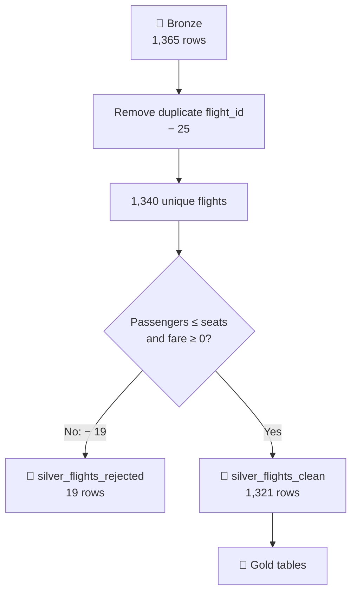

<div align="center">

# Reconciliation

**Airline Flight Operations Analytics Platform**


</div>

[← Back to README](../README.md) · [Data Quality Rules](data_quality_rules.md) · [Review Questions](review_questions.md)

---

## 1. What Is Reconciliation?

Reconciliation means proving that **every input row is accounted for**: kept, rejected, or removed as a duplicate. If the totals do not balance, rows were silently lost or double counted, and the Gold numbers cannot be trusted.

This satisfies business requirement **BR-06**: *Prove that Bronze rows = clean rows + rejected rows + duplicates removed.*

---

## 2. The Equation

```text
bronze_rows  =  clean_rows  +  rejected_rows  +  duplicate_rows
```

| Component | Source | Reference value |
|---|---|---:|
| `bronze_rows` | `COUNT(*)` on `bronze_airline_flights` | **1,365** |
| `clean_rows` | `COUNT(*)` on `silver_flights_clean` | **1,321** |
| `rejected_rows` | `COUNT(*)` on `silver_flights_rejected` | **19** |
| `duplicate_rows` | `COUNT(*) - COUNT(DISTINCT flight_id)` on Bronze | **25** |
| **Check** | 1,321 + 19 + 25 | **1,365 ✔** |

Reference values come from the example dashboard in the project brief. Your run should match them.

### Where the 19 rejected rows come from

| Reject reason | Rows |
|---|---:|
| Passengers more than seats | 11 |
| Average fare is negative | 8 |
| **Total** | **19** |

---

## 3. Row Flow



---

## 4. `gold_data_quality` Table

One row that holds both the problem counts (measured on Bronze, before fixing) and the reconciliation result.

```sql
CREATE OR REFRESH MATERIALIZED VIEW gold_data_quality AS
SELECT
  COUNT(*)                                                         AS bronze_rows,
  COUNT(*) - COUNT(DISTINCT flight_id)                             AS duplicate_rows,

  -- Problems found in Bronze
  SUM(CASE WHEN passengers > seat_capacity THEN 1 ELSE 0 END)      AS overbooked_rows,
  SUM(CASE WHEN avg_fare < 0 THEN 1 ELSE 0 END)                    AS negative_fare_rows,
  SUM(CASE WHEN airline IS NULL OR TRIM(airline) = ''
           THEN 1 ELSE 0 END)                                      AS missing_airline_rows,
  SUM(CASE WHEN delay_minutes IS NULL THEN 1 ELSE 0 END)           AS missing_delay_rows,
  SUM(CASE WHEN ticket_revenue IS NULL THEN 1 ELSE 0 END)          AS missing_revenue_rows,
  SUM(CASE WHEN delay_reason IS NULL OR TRIM(delay_reason) = ''
           THEN 1 ELSE 0 END)                                      AS missing_reason_rows,

  -- Outcome of cleaning
  (SELECT COUNT(*) FROM silver_flights_clean)                      AS clean_rows,
  (SELECT COUNT(*) FROM silver_flights_rejected)                   AS rejected_rows
FROM bronze_airline_flights;
```

> **Note:** these problem counts are measured on all Bronze rows, including duplicates, so they describe the raw file. They are not expected to add up to `rejected_rows`.

### Reconciliation flag

```sql
SELECT
  bronze_rows,
  clean_rows,
  rejected_rows,
  duplicate_rows,
  clean_rows + rejected_rows + duplicate_rows                      AS accounted_rows,
  bronze_rows - (clean_rows + rejected_rows + duplicate_rows)      AS unaccounted_rows,
  CASE WHEN bronze_rows = clean_rows + rejected_rows + duplicate_rows
       THEN 'Yes' ELSE 'No' END                                    AS reconciliation_passed
FROM gold_data_quality;
```

Expected result:

| bronze_rows | clean_rows | rejected_rows | duplicate_rows | accounted_rows | unaccounted_rows | reconciliation_passed |
|---:|---:|---:|---:|---:|---:|:---:|
| 1,365 | 1,321 | 19 | 25 | 1,365 | 0 | Yes |

---

## 5. Additional Cross-Checks

Reconciliation at row level is the main proof. These extra checks tie the layers and the dashboard together.

| # | Check | Expected |
|---|---|---|
| 1 | Bronze row count after load | 1,365 |
| 2 | `SUM(flights)` in `gold_monthly_flights` | 1,321 (= `clean_rows`) |
| 3 | `SUM(flights)` in `gold_airline_summary` | 1,321 |
| 4 | `SUM(flights)` in `gold_route_summary` | 1,321 |
| 5 | `SUM(flights)` in `gold_delay_summary` | 1,321 |
| 6 | On Time + Minor Delay + Major Delay | 1,321 |
| 7 | Dashboard **Total Flights** card | 1,321 |
| 8 | Dashboard **Bronze rows** card | 1,365 |
| 9 | Distinct `flight_id` in `silver_flights_clean` | 1,321 (no duplicates) |
| 10 | Rows in Silver clean with `passengers > seat_capacity` or `avg_fare < 0` | 0 |

```sql
-- Checks 2 to 6 in one query (all should return 1,321)
SELECT 'monthly' AS source, SUM(flights) AS flights FROM gold_monthly_flights
UNION ALL SELECT 'airline', SUM(flights) FROM gold_airline_summary
UNION ALL SELECT 'route',   SUM(flights) FROM gold_route_summary
UNION ALL SELECT 'delay',   SUM(flights) FROM gold_delay_summary
UNION ALL SELECT 'clean',   COUNT(*)     FROM silver_flights_clean;
```

---

## 6. Troubleshooting: Reconciliation Failed

If `unaccounted_rows` is not 0, find the missing rows first, then fix the rule.

### Find flights that are in neither Silver table

```sql
SELECT DISTINCT b.flight_id
FROM bronze_airline_flights b
LEFT ANTI JOIN silver_flights_clean    c ON b.flight_id = c.flight_id
LEFT ANTI JOIN silver_flights_rejected r ON b.flight_id = r.flight_id;
```

### Common causes

| Symptom | Likely cause | Fix |
|---|---|---|
| `unaccounted_rows` **> 0** (rows missing) | Rows with NULL `passengers` or `avg_fare` fail the expectation (so they are dropped from clean) but do not match the rejected filter, because comparisons with NULL are not true | Add an explicit rule and reject reason for NULL values, or confirm none exist |
| `unaccounted_rows` **< 0** (rows over counted) | A bad flight that is also duplicated appears twice in the rejected table and is also counted in `duplicate_rows` | Use `SELECT DISTINCT` (or deduplicate by `flight_id`) in `silver_flights_rejected` |
| `duplicate_rows` too low | Duplicates differ slightly (for example one copy has a blank), so `DISTINCT` keeps both | Deduplicate with `ROW_NUMBER() OVER (PARTITION BY flight_id ORDER BY loaded_at)` and keep row 1 |
| `bronze_rows` not 1,365 | CSV not fully loaded, extra file in the Volume, or the file was loaded twice | Check `source_file` and `loaded_at` in Bronze, remove stray files |
| `clean_rows` too high | Duplicates not removed | Revisit DQ-02 |
| Dashboard Total Flights differs from `clean_rows` | Dashboard not refreshed, or a filter is applied | Re-run the pipeline, then refresh the dashboard, clear filters |

### Diagnostic query: Bronze rows by outcome

```sql
SELECT
  CASE
    WHEN b.passengers > b.seat_capacity OR b.passengers < 0 OR b.avg_fare < 0 THEN 'rejected'
    ELSE 'candidate clean'
  END AS bucket,
  COUNT(*) AS rows_incl_duplicates
FROM bronze_airline_flights b
GROUP BY 1;
```

---

