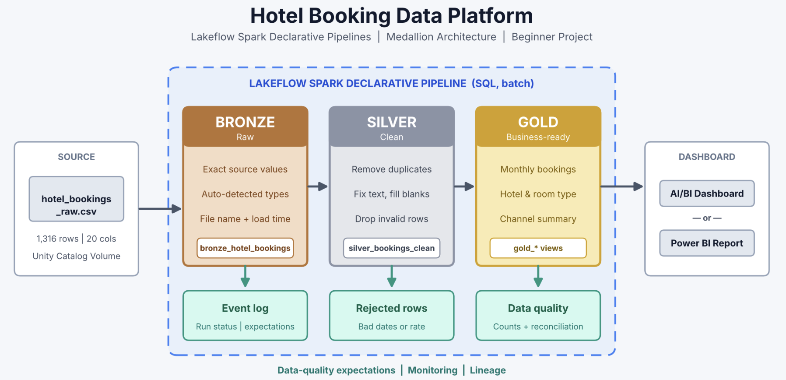
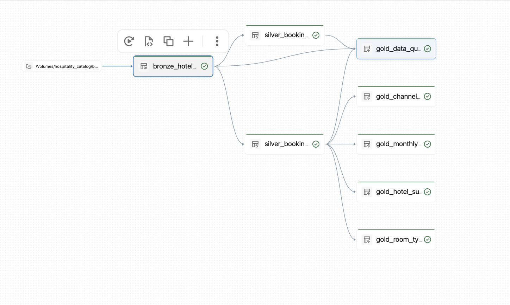
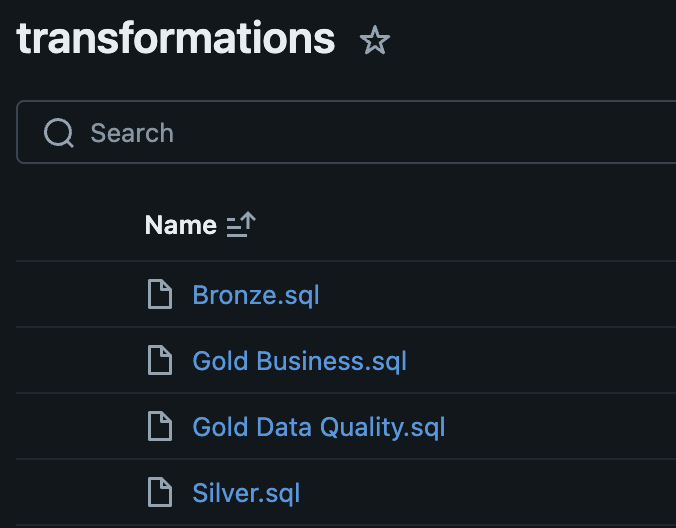

# Hotel Booking Analytics Platform

A data engineering project built using Databricks and Lakeflow Spark Declarative Pipelines to analyze hotel booking data using Medallion Architecture.

## Business Problem

The project transforms raw hotel booking data into clean, reliable datasets and business insights to analyze bookings, revenue, hotel performance, room types, and booking channels.

## Architecture




## Pipeline Lineage



## Tech Stack

- Databricks
- Lakeflow Spark Declarative Pipelines
- Databricks SQL
- Unity Catalog
- Medallion Architecture

## Dataset

- File: `hotel_bookings_raw.csv`
- Records: 1,316
- Columns: 20
- Data: 2025 hotel booking information

## Repository Structure

```text
Hotel_Booking_Medallion_Project/
│
├── README.md
├── Bronze/
├── Silver/
├── Gold Date Quality/
├── Gold Business/
└── images/
    ├── architecture.png
    ├── pipeline_lineage.png
    └── workspace_structure.png
```

## Pipeline Layers

### Bronze
Stores raw hotel booking data with source file and load timestamp information.

### Silver
Cleans data, removes duplicates, handles missing values, and separates rejected records.

### Gold
Creates business-level analytical tables and data quality reports.

## Gold Business Tables

- gold_monthly_bookings
- gold_hotel_summary
- gold_room_type_summary
- gold_channel_summary
- gold_data_quality

## Workspace Structure



## Data Quality

- Duplicate booking removal
- Missing value handling
- Standardized text fields
- Invalid date validation
- Negative room rate validation
- Clean and rejected record separation

## Dashboard

The dashboard covers:

- Booking and revenue overview
- Hotel performance
- Room type analysis
- Booking channel analysis
- Data quality monitoring

## Key Learnings

- Implemented Medallion Architecture.
- Built data transformation pipelines in Databricks.
- Applied data quality expectations.
- Created Gold analytical tables.
- Practiced data engineering workflows.

## Future Improvements

- Add more business KPIs.
- Automate pipeline monitoring.
- Enhance dashboard visualizations.

## License

This project is created for learning and portfolio purposes.